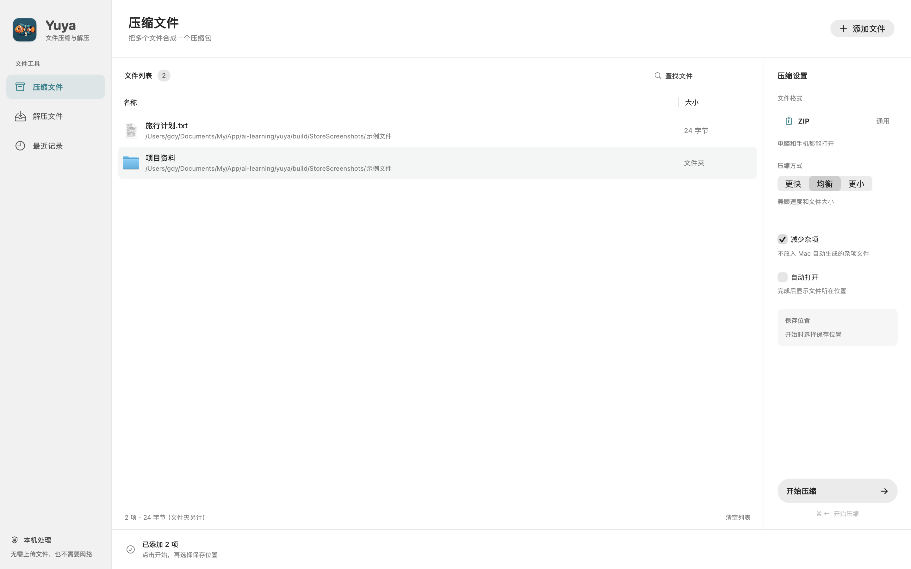
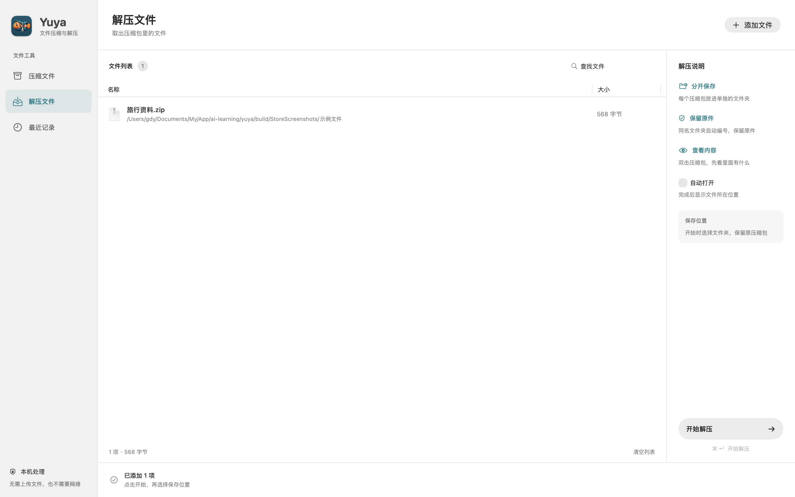
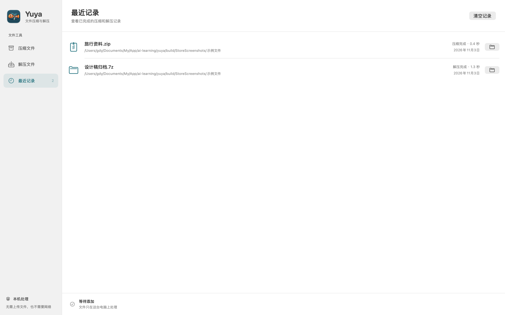
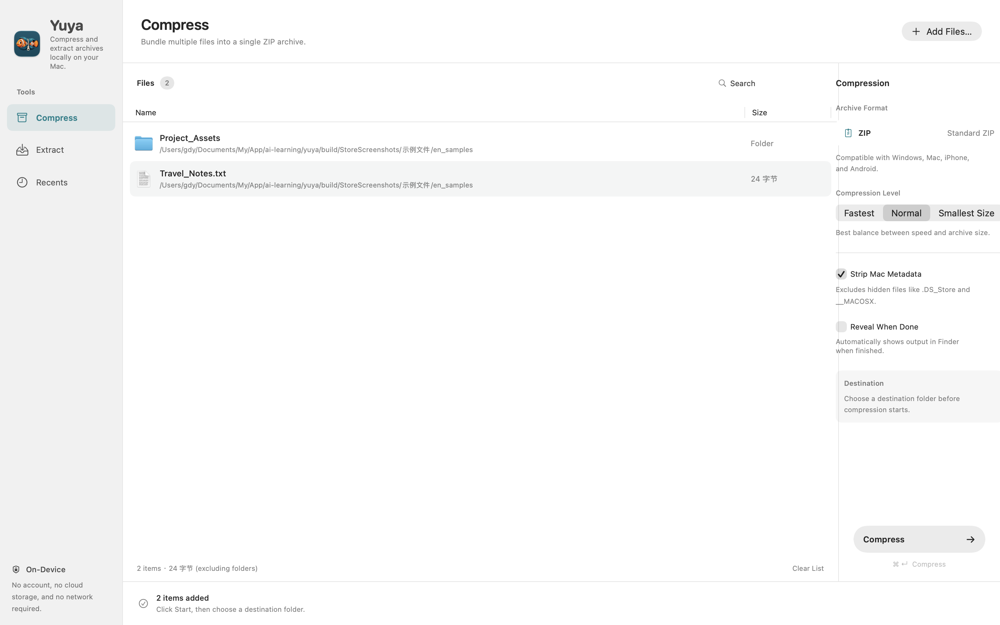

# 鱼压 / YUYA

> 面向 macOS 14+ 的轻量、原生解压缩工具。遵循苹果人机交互指南（HIG）与简洁设计理念，无需命令行依赖或外部网络，零数据收集，保护隐私。

[简体中文](README.md) | [English](README_EN.md)

[](https://github.com/richardguancn/yuya)
[](#)
[](#)
[](LICENSE)

---

## 应用界面 / Screenshots

| 快速压缩 (Compress) | 解压与包内预览 (Extract & Preview) |
| :---: | :---: |
|  |  |

| 最近任务记录 (History) | 原生英文界面 (Native English) |
| :---: | :---: |
|  |  |

---

## 核心特性

- **极简原生体验**：遵循《Don't Make Me Think》与《写给大家看的设计书》原则，菜单名称 2–4 字、说明精炼、通俗直观。
- **中英双语支持**：完整支持简体中文与 Native English，界面随系统语言自动自适应，无翻译腔。
- **多格式解压与预览**：创建 ZIP；浏览并提取 ZIP、7Z、RAR、TAR、GZIP、BZIP2、XZ。解压前可快速预览压缩包内部文件结构。
- **纯净压缩**：默认自动过滤 `.DS_Store`、`._*` 资源叉与 `__MACOSX` 目录，避免跨平台共享时的文件杂质。
- **安全沙盒机制**：运行于 macOS App Sandbox 安全沙盒环境，防护目录遍历与非法路径写入；解压采用原子安全替换，保护原始文件。
- **系统深度集成**：支持“打开方式”与 macOS 访达（Finder）右键快速操作服务，拖拽即用。

---

## 使用指南

1. **选择与拖拽**：在“压缩文件”或“解压文件”窗口中直接拖入文件或文件夹，亦可按 `⌘O` 打开选择器。
2. **列表与预览**：支持在文件列表中搜索、按名称或大小排序；解压前双击压缩包或按空格键可进行包内目录结构预览（支持最多 10,000 项统计）。
3. **开始处理**：按 `⌘↵`（Command + Return）选择目标位置并开始处理；支持随时取消，并在完成后一键在访达中定位。
4. **最近记录**：支持回溯最近 30 次任务记录，可快捷定位产物，清理历史记录不会误删原始文件。

---

## 格式支持与安全边界

- **压缩格式**：目前专注于创建跨平台通用的 ZIP 归档。
- **解压与预览**：支持 ZIP、7Z、RAR、TAR、GZIP、BZIP2、XZ 等主流归档格式（基于底层流式 `libarchive`）。
- **安全策略**：
  - 拒绝绝对路径、向上越界的路径（`../`）及非法软硬链接，杜绝 Zip-Slip 目录穿透风险。
  - 拒绝特殊设备文件及非法字符路径。
  - 单独临时目录解压并原子发布，任务取消或意外中断时自动清理残留文件。

---

## 本地开发与构建

### 环境要求
- macOS 14.0 (Sonoma) 或更高版本
- Xcode 15.0+ 或 Swift 6.0+ 工具链

### 构建与测试

在项目根目录下执行：

```bash
# 运行单元测试
./scripts/test.sh

# 文案规范与长度检查
python3 scripts/check_copy.py

# 快速编译 Release 版本
./scripts/build.sh
```

编译产物位于 `build/Build/Products/Release/Yuya.app`。

---

## 打包与分发

### 离线安装包（DMG / ZIP）

```bash
# 生成 ZIP 压缩分发包
./scripts/package.sh

# 生成 DMG 安装镜像（含 Applications 软链接）
./scripts/package-dmg.sh
```

成品将生成至 `dist/` 目录下，包含 Apple Silicon 与 Intel 架构包。

### Mac App Store 归档

应用已完整适配 Mac App Store 沙盒权限及内建权限凭据机制：

```bash
# 本地沙盒验证归档
./scripts/archive-store.sh local

# 正式发布签名归档（需开发者账号证书）
./scripts/archive-store.sh signed
```

---

## 仓库地址与开源

- **GitHub 仓库**：[https://github.com/richardguancn/yuya.git](https://github.com/richardguancn/yuya.git)
- **开发者主页**：[https://github.com/richardguancn](https://github.com/richardguancn)
- **问题反馈**：[Issues](https://github.com/richardguancn/yuya/issues)

欢迎提交 Issue 与 Pull Request 共同改进鱼压！
