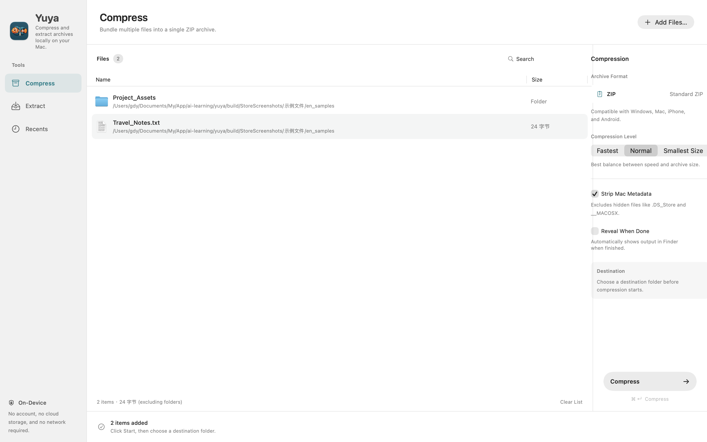
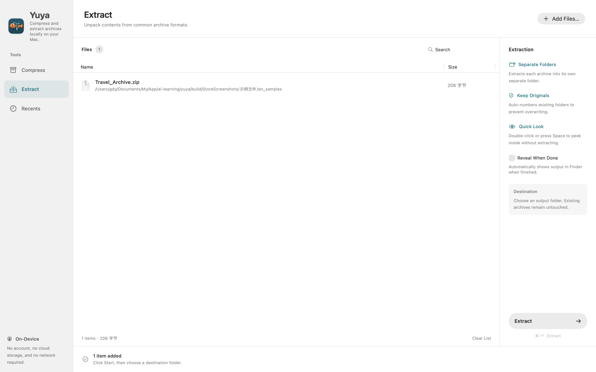
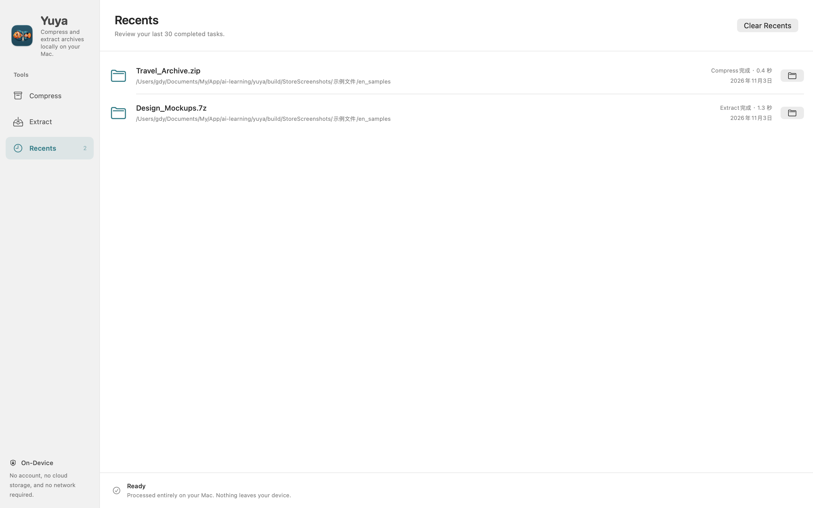

<p align="center">
  
</p>

<h1 align="center">YUYA / 鱼压</h1>

<p align="center">
  <strong>A fast, native, and clutter-free archive utility designed for macOS 14+</strong><br />
  Built with simplicity and Apple Human Interface Guidelines in mind. No command-line dependencies, no external network requests, zero data collection.
</p>

<p align="center">
  <a href="README_EN.md"><b>English</b></a> | <a href="README.md"><b>简体中文</b></a>
</p>

<p align="center">
  <a href="https://github.com/richardguancn/yuya"></a>
  <a href="https://github.com/richardguancn/yuya/releases/latest"></a>
  
  
  <a href="LICENSE"></a>
</p>

---

## Screenshots

| Compress Files | Extract & Live Preview |
| :---: | :---: |
|  |  |

| Recent Task History |
| :---: |
|  |

---

## Key Features

- **Intuitive & Minimalist**: Built on "Don't Make Me Think" and "The Non-Designer's Design Book" principles. Concise labels, everyday phrasing, and zero jargon.
- **Bilingual by Design**: Fully localized in Native English and Simplified Chinese. Adapts automatically to your system language preference without awkward translations.
- **Inspect Before Extracting**: Create clean standard ZIP files. Inspect and extract ZIP, 7Z, RAR, TAR, GZIP, BZIP2, and XZ archives. Peek into internal folder trees before unpacking.
- **Clean Cross-Platform Archives**: Automatically strips macOS metadata (`.DS_Store`, `._*` resource forks, and `__MACOSX` folders) by default for seamless sharing with Windows and Linux users.
- **Sandboxed & Safe**: Runs strictly inside the macOS App Sandbox. Thoroughly protected against Zip-Slip path traversal attacks, malicious symlinks, and absolute paths. Employs atomic publishing to prevent incomplete output.
- **Deep macOS Integration**: Drag-and-drop workflow, "Open With" integration, and Finder Quick Action / Services.

---

## User Guide

1. **Select & Drop**: Drag files or folders directly into the "Compress" or "Extract" window, or press `⌘O` to browse.
2. **Review & Preview**: Filter by search, sort by filename or uncompressed size. Double-click or press `Space` to inspect archive contents before extracting (handles up to 10,000 preview items).
3. **Process**: Press `⌘↵` (Command + Return) to pick a destination folder and start. Cancel at any time, or click to reveal the result in Finder immediately upon completion.
4. **Recent History**: Review your last 30 operations with quick jump buttons. Clearing task history never removes your actual files.

---

## Supported Formats & Security Boundaries

- **Creation**: Standard cross-platform ZIP archives.
- **Extraction & Preview**: ZIP, 7Z, RAR, TAR, GZIP, BZIP2, and XZ via streaming `libarchive`.
- **Security Protections**:
  - Rejects absolute paths, escaping parent paths (`../`), and escaping symlinks/hardlinks.
  - Rejects special device nodes and invalid filenames.
  - Extracts into private temporary folders before publishing atomically; automatically cleans up partial files on cancellation or failure.

---

## Local Development & Build

### Prerequisites
- macOS 14.0 (Sonoma) or later
- Xcode 15.0+ or Swift 6.0+ toolchain

### Build & Test

Run the following commands in the project root:

```bash
# Run unit and integration tests
./scripts/test.sh

# Validate copy rules and localization alignment
python3 scripts/check_copy.py

# Build Release binary
./scripts/build.sh
```

The compiled application bundle will be located at `build/Build/Products/Release/Yuya.app`.

---

## Packaging & Distribution

### Standalone Installers (DMG / ZIP)

```bash
# Generate signed ZIP distribution package
./scripts/package.sh

# Generate mounted DMG installer with Applications shortcut
./scripts/package-dmg.sh
```

Built outputs will be placed in the `dist/` directory, supporting Apple Silicon and Intel architectures.

### Mac App Store Archive

Yuya is fully configured for Mac App Store sandboxing and security-scoped bookmark persistence:

```bash
# Local sandbox verification archive
./scripts/archive-store.sh local

# Production signed archive (requires Apple Developer credentials)
./scripts/archive-store.sh signed
```

---

## Repository & Open Source

- **GitHub Repository**: [https://github.com/richardguancn/yuya.git](https://github.com/richardguancn/yuya.git)
- **Author Profile**: [https://github.com/richardguancn](https://github.com/richardguancn)
- **Issue Tracker**: [Issues](https://github.com/richardguancn/yuya/issues)

Feedback and pull requests are warmly welcomed!
